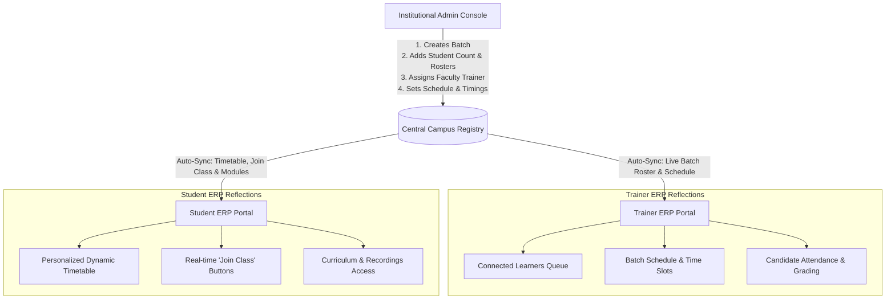
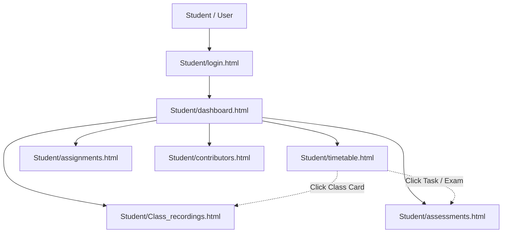

# SETU CampusOS — Administrator & System Guide

Welcome to the **SETU CampusOS** administrative guide. This document provides a clean, human-readable reference for system administrators, institutional staff, and developers managing the CampusOS platform.

---

## 1. Quick Access & Credentials

| Role | Authorized Email / Username | Default Password | Access Level |
| :--- | :--- | :--- | :--- |
| **Student (Primary)** | `shashaank.s@campusos.edu` | *(Any password / student token)* | Full Student Portal Access |
| **Institutional Admin** | `admin@campusos.edu` | `CampusOS@2026!` | Administrative & Provisioning Console |
| **Faculty / Instructor** | `faculty.ravi@campusos.edu` | `Faculty#2026` | Gradebook, Timetable & Class Sessions |

> **Note on Account Provisioning:** New student profiles and learner credentials must be provisioned through the Institutional Admin Registry before access is activated.

---

## 2. Portal Pages & Route Directory

All student portal pages are located in the `Student/` directory:

| Page / Route | File Path | Description |
| :--- | :--- | :--- |
| **Home / Landing** | `Student/index.html` | Main public entrance, feature highlights, and campus overview. |
| **Sign In** | `Student/login.html` | Dark Matrix cyber-themed authentication portal with interactive 3D Bot mascot. *(Locked)* |
| **Student Dashboard** | `Student/dashboard.html` | Central learner hub with attendance metrics, active tasks, notifications, and modules. |
| **Academic Timetable** | `Student/timetable.html` | Interactive Multi-Month Timetable with Month/Week/List views, dynamic deadline progress bars, and calendar export. |
| **Class Recordings** | `Student/Class_recordings.html` | Video archives with synchronized transcripts, instructor notes, and speed control. |
| **Assessments & Exams** | `Student/assessments.html` | Proctored exam schedules, online test portal, scoring rubrics, and submission guidelines. |
| **Assignments & Tasks** | `Student/assignments.html` | Problem set submissions, deadline trackers, and faculty grading feedback. |
| **Contributors & Alumni** | `Student/contributors.html` | Alumni showcase, contributor profiles (featuring Shashaank Sajjanar), and career metrics. |
| **Registration Portal** | `Student/student_registration_portal.html` | Admissions and institutional enrollment management. |
| **Mobile Proctor** | `Student/mobile_proctor.html` | AI-powered dual-camera examination proctoring. |

---

## 3. Batch Creation & Institutional Management (Admin-Exclusive)

> [!IMPORTANT]
> **Strict Administrative Authority:**
> Batches can **ONLY be created and configured by the Institutional Administrator**. Trainers and students do not have permissions to create batches or modify enrollment structures.

### Admin Batch Provisioning Capabilities
Within the Admin ERP Console, the Institutional Administrator possesses full end-to-end authority to:
1. **Create New Batches:** Initialize academic batches with unique batch identifiers (e.g., `Batch B-948`, `Batch B-949`, `Batch AI-ML-01`), semester levels, and program tracks.
2. **Add & Manage Student Rosters:**
   - Define batch capacity and add the exact number of enrolled students.
   - Associate student profile IDs (`2026-STU-XX`), names, and institutional emails with the batch.
   - Activate, suspend, or transfer students between batches in real time.
3. **Assign Faculty Trainers:**
   - Allocate primary and secondary trainers/instructors (e.g., Prof. Vikram Rao, Ravi Sir, Gauthami Ma'am, Suresh Sir) to each specific batch.
   - Designate evaluation leads for coursework, biometrics, and speech telemetry proctoring.
4. **Configure Timings & Venues:**
   - Set lecture/lab days (e.g., Monday through Friday, weekend slots).
   - Define exact start and end timings (e.g., `10:30 AM – 11:30 AM`, `11:30 AM – 12:30 PM`).
   - Assign physical/virtual venues (e.g., `Room B-949`, `Lab 4`, `Live Video Stream`).

---

### Automated Multi-Portal ERP Synchronization

Once the Admin provisions or modifies a batch, all changes instantly propagate across the ecosystem:



#### 1. Reflections on Trainer ERP
- **Live Connected Learner Queue:** Trainers instantly see the assigned batch along with the enrolled student roster, student IDs, attendance rates, and CGPA metrics.
- **Session Schedule:** Configured timings automatically populate the trainer's daily teaching agenda and lecture queue.
- **Grading & Proctoring:** Grants the assigned trainer access to evaluate batch assignments, exams, and candidate telemetry.

#### 2. Reflections on Student ERP
- **Personalized Timetable:** Enrolled students automatically see their batch classes, subjects, rooms, and assigned faculty in `Student/timetable.html`.
- **Dynamic Action Pills:** Displays `Join class` buttons and dynamic countdown progress bars for upcoming batch timings.
- **Resource Access:** Unlocks batch-specific syllabus modules, assessment trackers, and class recordings in `Student/Class_recordings.html`.

---

## 4. Academic Calendar & Timetable Governance

The timetable system is governed centrally through the Admin Console and rendered via `academicDatabase` inside `Student/timetable.html`:

### Institutional Holiday & Recess Assignment (Admin-Exclusive)

> [!IMPORTANT]
> **Admin-Only Holiday Assignment:**
> Declaring and assigning **Holidays, Non-Instructional Days, Semester Recesses, and Exam Blackout Dates** on the academic timetable is **STRICTLY done by the Institutional Admin only**. 
> - Neither faculty trainers nor students have permissions to declare, modify, or override institutional holidays.

#### How Holiday Assignment Works:
1. **Admin Declaration:** The Admin assigns official holidays (e.g., *Republic Day*, *Mid-Semester Recess*, *Institutional Festival Days*, *Regional Holidays*) in the central calendar registry.
2. **Automated Class Suspension:** On designated holiday dates, all batch classes, recurring lectures, and lab sessions are automatically marked as suspended or non-active.
3. **Cross-Portal Reflection:**
   - **Student ERP (`Student/timetable.html`):** The date is highlighted with an official **Holiday Badge / Banner** (e.g., `🎉 Holiday - Campus Closed`), preventing scheduling confusion and disabling `Join Class` pills for that day.
   - **Trainer ERP:** The trainer's session queue reflects the holiday, ensuring attendance is not penalized and no classes are scheduled.

### Key Batches & Instructors (Semester VI)
- **Excel & Analytics:** Ravi Sir (`Room B-949`, 10:30 AM – 11:30 AM)
- **Advanced Statistics:** Ravi Sir (`Room B-954`, 11:30 AM – 12:30 PM)
- **Python Programming & ML:** Gauthami Ma'am (`Lab 4`, 12:30 PM – 01:30 PM)
- **Power BI Storytelling:** Suresh Sir (`Room B-953`, 09:30 AM – 11:30 AM Saturdays)

### Dynamic Timeline & Deadline Logic
- **Task & Exam Bars:** Dynamically compute elapsed time from `startTime` to `deadline`.
- **Status Indicators:**
  - `Completed`: Marked in **Emerald Green** (`#10b981` / `border-l-emerald-500`) with a `✓ Completed` badge.
  - `Active`: Displayed in **Cyber Blue** (`#2563eb`) with an active indicator.
  - `Upcoming`: Displays a **`Join class`** or countdown pill (e.g., `2h 34m left`).
  - `Holiday`: Marked in **Amber / Purple Banner** indicating official institutional non-working day.

---

## 5. Running the Local Development Server

To start or restart the local web server:

```powershell
# Navigate to project root and run Python server
python server.py
```

The portal will be live at:
- **Local:** `http://localhost:5500`
- **Network / LAN:** `http://<YOUR_LOCAL_IP>:5500`

---

## 6. System Architecture & Tech Stack



- **Frontend Core:** Pure Semantic HTML5 + Modern Vanilla CSS & Tailwind CSS utility classes + Vanilla JavaScript (ES6+).
- **Icons & Fonts:** FontAwesome 6.4 + Plus Jakarta Sans & Google Inter typography.
- **Server:** Lightweight Python HTTP/HTTPS multithreaded server (`server.py`).

---

## 7. Locked Files Policy

The following pages are strictly locked to preserve their design and branding:
1. `Student/login.html` & `Student/css/login.css` *(Dark Cyber Matrix Theme)*
2. `Student/index.html` & root `index.html` *(Public Landing)*

---

*SETU CampusOS • Smarter Campuses, Brighter Futures • Version 2026.1*
